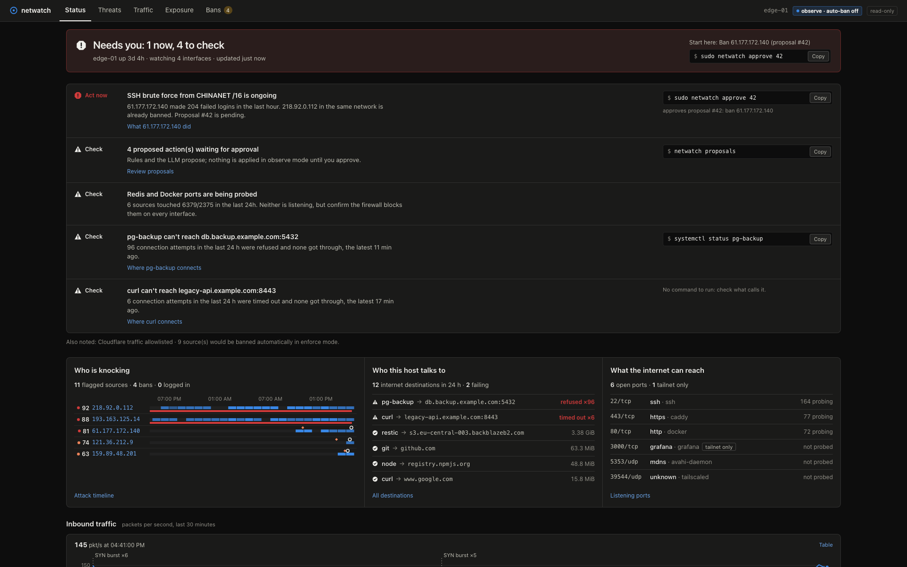
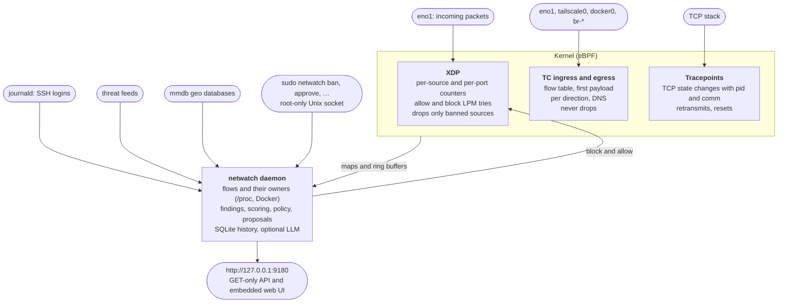
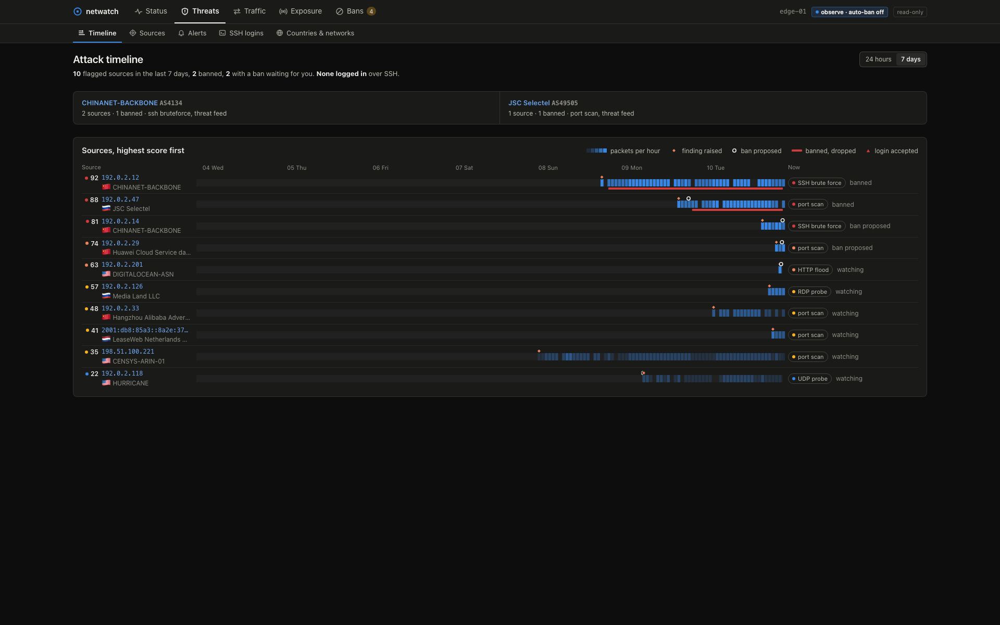
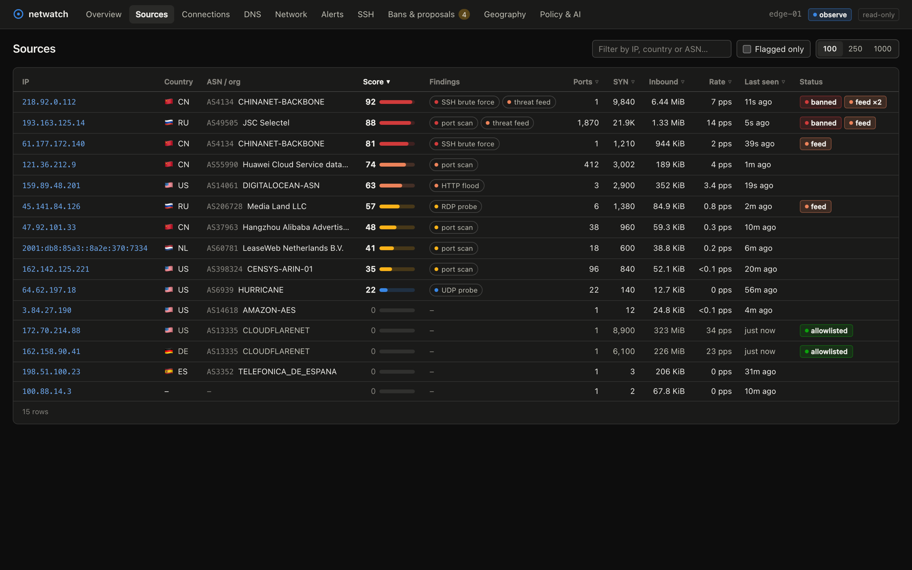
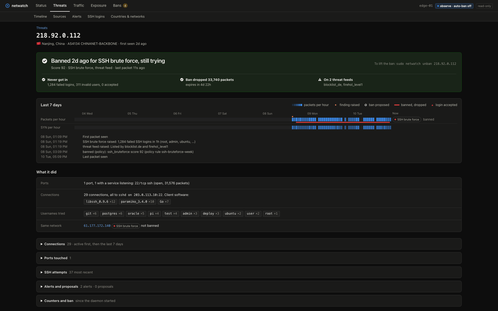
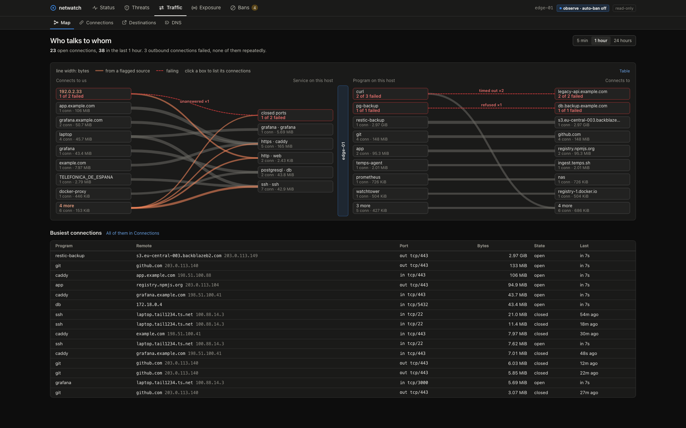
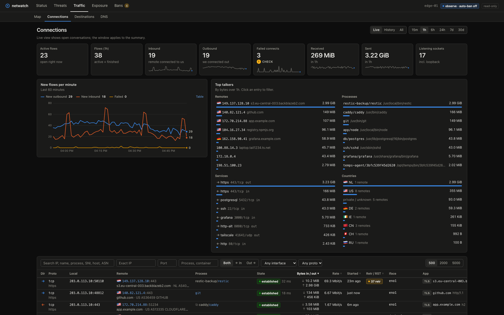
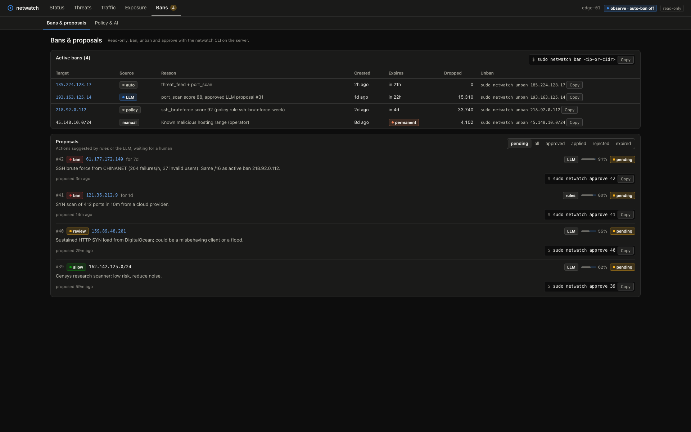
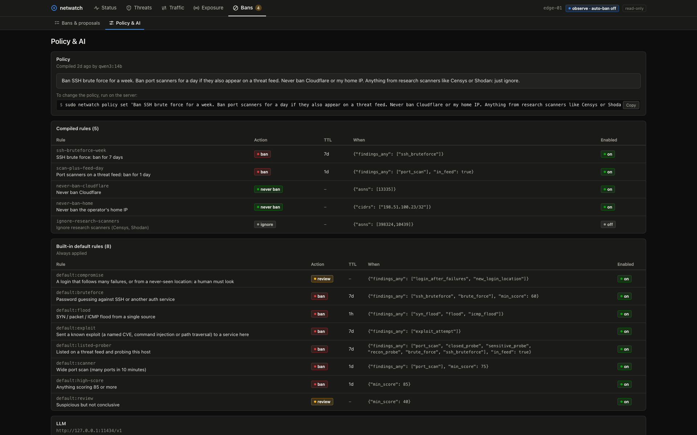

# netwatch

netwatch is a single-binary traffic monitor for Linux servers and macOS: it shows every connection with the process behind it, flags attackers, and proposes bans that you approve.

```shell
curl -fsSL https://gotempsh.github.io/netwatch/install.sh | sh
```

That installs a systemd service (a launchd daemon on macOS) in **observe** mode: it watches and proposes, and blocks nothing until you approve. It needs Linux 5.8 or newer on x86_64 or aarch64, or macOS. [Install](#install) covers Docker and building from source.



**[Try the live demo](https://gotempsh.github.io/netwatch/demo/)**, the web UI on demo data in your browser, nothing to install.

[Documentation](https://gotempsh.github.io/netwatch/) · [Quick start](https://gotempsh.github.io/netwatch/quick-start/) · [AI agents](https://gotempsh.github.io/netwatch/agents/) · [Releases](https://github.com/gotempsh/netwatch/releases) · [Contributing](CONTRIBUTING.md)

On Linux, netwatch is built on [aya](https://github.com/aya-rs/aya) eBPF/XDP. It also runs [on macOS](#macos), with /dev/bpf capture and pf instead of eBPF. It:

- counts every packet on an interface inside the kernel;
- records every connection on the host, Tailscale and Docker interfaces, with the process or container behind it, DNS names, TLS SNI, HTTP hosts and SSH banners;
- geolocates sources with MaxMind-format databases;
- follows SSH logins;
- flags port scans, brute force, floods and listed attackers;
- proposes bans, or enforces them at XDP speed.

You browse the results in a read-only web UI that listens only on `127.0.0.1`.

It runs as root, so [Security and privacy](https://gotempsh.github.io/netwatch/security/) lists every outbound request it makes, what it stores and how to verify a release. [Compared to other tools](https://gotempsh.github.io/netwatch/comparison/) sets it next to fail2ban, CrowdSec, ntopng, Suricata, OpenSnitch and Little Snitch. To report a vulnerability, see [SECURITY.md](SECURITY.md).

Optionally, it can use any OpenAI-compatible model. The model reviews the sources the rules can't settle, and turns plain-English ban policies into rules. It is designed for cheap models and small token budgets.



## A look around

**Status.** The page that opens first says whether anything needs you. Each item gives what netwatch saw, a link to the evidence and the command that fixes it, and below them, who is knocking, who this host talks to and what the internet can reach.

**Attack timeline.** The flagged sources active in the last 7 days, one lane each, with when each finding, proposal, ban and login happened.



**Sources.** Every address that sent traffic, scored 0–100, with what it did, its network, and whether it's banned, allowlisted or on a threat feed.



**One source.** What it did and where it stands: whether it got in, what its ban dropped, which feeds list it, seven days of history with its events, and the next command.



**Who talks to whom.** The host in the middle: who connects in and to which service, which program connects out and to whom. Failing connections are dashed red and say why.



**Connections.** Every flow on the host with the process or container behind it, the name it was resolved from, and who it talks to most.



**Bans and proposals.** In `observe` mode nothing is blocked until you approve it. Each proposal says who suggested it (rules or the model), why, and the command to apply it.



**Policy in plain English.** Write the policy as a sentence; the model compiles it into rules you can read before they apply.



The screenshots use the UI's demo data. To click through it without installing anything, open the [live demo](https://gotempsh.github.io/netwatch/demo/).

## What it does

- **Traffic accounting in XDP.** It counts packets, bytes, SYNs, inbound UDP and ICMP per source, plus every local port each source touches. A source is "inbound" when it opens connections to us; replies to our own connections don't count. The program fails open: it only drops sources you banned.
- **Detection.** Findings:
  - port scans and probes of closed ports;
  - probes of services that should never be public (Telnet, SMB, Redis, Docker, …);
  - SYN/connection brute force against auth ports;
  - SYN, UDP and ICMP floods, plus a global SYN-rate alarm;
  - threat feed matches, including outbound traffic from this host to listed IPs. The defaults are the parts of [FireHOL level1](https://iplists.firehol.org/?ipset=firehol_level1), loaded separately (Spamhaus DROP, DShield, Feodo and Team Cymru full bogons), so each match shows which list and which listed range it came from;
  - watched countries.

  Each source gets a 0–100 score.
- **SSH monitoring.** It follows `ssh`/`sshd` and Tailscale SSH in journald and flags:
  - password brute force and invalid users;
  - a successful login after failures;
  - logins from a country or ASN not seen in the last 90 days.

  It also warns when sshd accepts passwords.
- **Connections.** TC programs keep a table of every flow on the primary interface, and on Tailscale, WireGuard and Docker interfaces. Each flow records:
  - direction (who connected to whom), bytes, packets and rates each way;
  - TCP state, connect latency, retransmits and resets (`unanswered` for a SYN no TCP packet answered: a probe a firewall dropped or refused with ICMP);
  - the owning process, with its systemd service or Docker container. This comes from the TCP tracepoints and a /proc scan every 15 s, and covers UDP, listeners and connections opened before netwatch started. A socket systemd opened for a service (socket activation, as for sshd on Ubuntu 24.04) belongs to the service.
  - application metadata parsed from the first payload in each direction: TLS SNI and ALPN, HTTP method, host, path, user agent and status, and SSH banners;
  - the DNS name the remote address was resolved from.

  netwatch also logs DNS queries and answers (with rcode and latency), listening sockets and who owns them, failed outbound connects, and new or closed listeners. Live flows are in memory; finished ones are stored for `flow_retention_days` (default 7).
- **Never ban what you depend on.** These are allowlisted in the kernel automatically:
  - private, CGNAT and link-local ranges;
  - the default gateway;
  - WireGuard endpoints;
  - Tailscale peers and DERP relays;
  - Cloudflare's ranges (so a Cloudflare tunnel keeps working).

  It also refuses bans broader than /16 (v4) or /32 (v6) unless you force them.
- **Observe first.** In the default `observe` mode, every ban is a *proposal* that you approve or reject. `enforce` mode bans automatically, with TTLs that escalate for repeat offenders (×4 per offence, up to 30 days).
- **Insights.** It turns the data into concrete advice, each with a command to run. Examples: "sshd accepts passwords", "port 5432 is reachable and being probed", "12 scanners from AS14061", "this host talked to a listed IP".

## Install

netwatch needs root and Linux 5.8 or newer (6.6 or newer attaches the TC programs with TCX; older kernels use a clsact qdisc).

Install the latest [release](https://github.com/gotempsh/netwatch/releases) as a systemd service (x86_64 or aarch64, built against glibc 2.35: Debian 12, Ubuntu 22.04, RHEL 10 or newer):

```shell
curl -fsSL https://gotempsh.github.io/netwatch/install.sh | sh
```

The script picks the archive for your OS and architecture, checks it against the release's `SHA256SUMS`, and installs it with `sudo`. Running it again upgrades netwatch and keeps your configuration. `NETWATCH_VERSION=v0.1.0` installs a specific release. Then, as you, it adds the agent skill for each coding agent with a folder in your home (`~/.claude` or `~/.cursor`, `~/.codex` or `~/.agents`); `NETWATCH_SKILL=0` skips it.

From 0.1.3, netwatch updates itself from the latest release. It checks the download against `SHA256SUMS`, and if the new daemon doesn't start, it puts the previous version back:

```shell
netwatch update --check          # is there a newer release? (no root)
sudo netwatch update             # install it and restart the daemon
sudo netwatch update --auto on   # install new releases daily (off by default)
```

To do the same by hand (use `aarch64` on ARM):

```shell
curl -fsSLO https://github.com/gotempsh/netwatch/releases/latest/download/netwatch-linux-x86_64.tar.gz
tar xzf netwatch-linux-x86_64.tar.gz
sudo netwatch-linux-x86_64/scripts/install.sh
```

Each release also has a build provenance attestation: `gh attestation verify netwatch-linux-x86_64.tar.gz -R gotempsh/netwatch`.

To build from source instead, you need:

- a Rust toolchain (stable and nightly with `rust-src`);
- [`bpf-linker`](https://github.com/aya-rs/bpf-linker);
- Node 22.12 or newer (or 20.19 or newer on Node 20), to build the UI. Other versions, Node 21 included, skip the bundler's native binding and the UI build fails with "Cannot find native binding".

```shell
rustup toolchain install stable
rustup toolchain install nightly --component rust-src
cargo install bpf-linker            # or use a prebuilt release

npm --prefix ui ci && npm --prefix ui run build   # the UI is embedded at compile time
cargo build --release
sudo scripts/install.sh
```

`install.sh` does the following:

- copies the binary to `/usr/local/bin`;
- writes `/etc/netwatch/netwatch.toml` (only if it doesn't exist), with `interface = "auto"`: the interface that carries the default route;
- downloads the free [DB-IP Lite](https://db-ip.com/db/lite.php) city and ASN databases (CC BY 4.0) and enables a monthly timer that refreshes them;
- starts `netwatch.service` in **observe** mode.

To use MaxMind GeoLite2 instead, point `geoip_city` / `geoip_asn` at those `.mmdb` files. Changed files are reloaded automatically.

XDP attaches in native driver mode when the NIC supports it, and falls back to generic mode (shown as `skb`) otherwise. On some drivers (igb, ixgbe, …), attaching resets the link for about 3 seconds.

To remove netwatch, follow [Uninstalling](https://gotempsh.github.io/netwatch/installation/#uninstalling).

### Docker

Each release publishes a multi-arch image (`linux/amd64`, `linux/arm64`) to `ghcr.io/gotempsh/netwatch`, tagged with the version and `latest`. The server only needs Docker:

```shell
docker run -d --name netwatch --restart unless-stopped --stop-timeout 30 \
  --network host --pid host --privileged \
  -v netwatch-data:/var/lib/netwatch -v /run/netwatch:/run/netwatch \
  ghcr.io/gotempsh/netwatch:latest
docker exec netwatch netwatch status
```

netwatch watches the host it runs on, so the container needs:

- `--network host`, to attach XDP/TC to the real interfaces (the UI stays on `127.0.0.1:9180`, no ports are published);
- `--pid host`, to see which process or container owns each connection;
- `--privileged`, for eBPF, tracepoints, and reading the host.

The `netwatch-data` volume keeps the database and the GeoIP data, which is downloaded on first start and refreshed monthly. `/run/netwatch` holds its sockets, so [temps](#temps) on the host can reach it; leave that mount out if you don't run temps. netwatch reads host files through `/proc/1/root` and runs the host's own `sshd -T`, `journalctl`, `ip`, `wg` and `tailscale` inside the host's mount namespace, so the image doesn't carry them and sees the host's real configuration. Run state-changing commands with `docker exec netwatch netwatch approve 7`.

Without a config file it runs with the defaults: the default-route interface, `observe` mode. To change settings, write a file (`docker run --rm ghcr.io/gotempsh/netwatch default-config` prints them all), mount it with `-v /etc/netwatch/netwatch.toml:/etc/netwatch/netwatch.toml:ro`, and pass `NETWATCH_SLACK_WEBHOOK` or `NETWATCH_LLM_API_KEY` with `-e` when you enable `[slack]` or `[llm]` in it.

`docker-compose.yml` runs the same container with [`deploy/netwatch.toml`](deploy/netwatch.toml) mounted (`docker compose up -d`, or `--build` to build the image from a checkout).

Run one copy per server: an interface takes one XDP program, so stop the old container before starting a new one. If a platform starts the new copy first, the new one fails to attach and keeps restarting until the old one exits. On a platform with security policies for containers (such as Temps), an administrator has to allow privileged containers, host networking and the host PID namespace.

`sudo IMAGE=ghcr.io/gotempsh/netwatch:latest scripts/e2e-netns.sh` runs the end-to-end test against the image.

### macOS

The same binary, UI, CLI, detection and ban policy run on macOS (developed on macOS 27, Apple Silicon). Only the layer under them differs:

| | Linux | macOS |
|---|---|---|
| Per-source accounting, flows, payload samples | XDP and TC programs | `/dev/bpf` capture threads, one per interface, feeding the same logic in userspace |
| TCP states, connect latency, failed connects | TCP tracepoints | read from the TCP flags on the wire |
| Which process opened a connection | tracepoint pid/comm, `/proc` scan | the capture header (macOS names the sending process of outgoing packets), libproc scan |
| Retransmits | `tcp_retransmit_skb` | the capture header's retransmit flag (our own retransmits only) |
| Bans | XDP drop | pf table in the anchor `com.apple/netwatch` |
| SSH logins | journald | the unified log (`log stream`) |
| Service | systemd | launchd |

The same command installs it as a launchd daemon (Apple Silicon or Intel):

```shell
curl -fsSL https://gotempsh.github.io/netwatch/install.sh | sh
```

The binary isn't notarized yet. `curl` doesn't mark it as downloaded, so Gatekeeper lets it run; a copy downloaded with a browser needs `xattr -d com.apple.quarantine netwatch` first. By hand, unpack `netwatch-macos-arm64.tar.gz` (or `-x86_64`) and run `sudo netwatch-macos-arm64/netwatch install`.

Or build from source (no eBPF toolchain needed):

```shell
npm --prefix ui ci && npm --prefix ui run build
cargo build --release
sudo target/release/netwatch install
```

`install` does the following:

- copies the binary to `/usr/local/bin/netwatch`;
- writes `/etc/netwatch/netwatch.toml` if it doesn't exist;
- downloads the DB-IP Lite databases into `/var/db/netwatch`, and schedules `netwatch update-geoip` monthly;
- starts the launchd daemon `dev.netwatch` in observe mode, logging to `/var/log/netwatch.log`.

`sudo netwatch uninstall` stops and removes it; add `--purge` to delete the config, database and log too. Secrets go in `/etc/netwatch/env` (`NETWATCH_SLACK_WEBHOOK=...`), which the daemon reads at startup because launchd has no environment file. Restart the daemon after editing either with `sudo launchctl kickstart -k system/dev.netwatch`.

Differences on macOS:

- **Defaults.** `interface = "auto"` is the default-route interface, usually `en0`. Flows are also recorded on `utun*` (Tailscale, WireGuard and other VPNs) and `bridge*` (UTM, Lima and other VMs). Docker Desktop runs its containers in a VM, so they show up as one bridged VM, not per container.
- **Bans.** The stock `/etc/pf.conf` evaluates `anchor "com.apple/*"`, so bans work without editing it. netwatch enables pf with a reference token, and removes its rules and releases pf when it stops, so bans only hold while it runs, as with XDP. With a custom `pf.conf` that lacks that anchor, add `anchor "com.apple/netwatch"` to it.
- **Capture cost.** Capture happens in userspace, so CPU use grows with traffic. That's fine for a workstation or a small server; it isn't line rate like XDP. Packets are cut at about 1.2 KB, and the log warns if the kernel drops captures.
- **Linux-only.** `xdp_mode`, `drop_syn_ip_options` and the CVE-2026-98432 alerts (a Linux TCP bug) don't apply. `ssh_units` is replaced by the unified log.
- **SSH.** SSH alerts need Remote Login (System Settings › General › Sharing). Without it, the "sshd accepts passwords" check is skipped.
- **Tailscale and WireGuard peers.** They are read from tailscaled's socket (`/var/run/tailscaled.socket`, the Homebrew or open-source tailscaled) or the Tailscale app's bundled CLI, and from wireguard-go's sockets in `/var/run/wireguard` (`wg-quick` from Homebrew). The WireGuard app from the App Store runs its tunnels in a network extension that netwatch can't ask, so add its endpoints with `sudo netwatch allow`.

`NETWATCH_PCAP=capture.pcap netwatch run` replays a capture file through the whole pipeline instead of capturing, without root. It is useful for testing rules: point `db_path` and the sockets at a scratch directory. It reads classic pcap (convert a Wireshark pcapng with `tcpdump -r in.pcapng -w out.pcap`).

## Use it

Open the UI through an SSH tunnel, since it never listens on a public address:

```shell
ssh -L 9180:127.0.0.1:9180 user@server   # then browse http://127.0.0.1:9180
```

The UI has five sections: Status; Threats (attack timeline, sources and each source's page, alerts, SSH logins, countries and networks); Traffic (the map, connections, destinations, DNS); Exposure (listening ports, interfaces and the sensor); and Bans (bans and proposals, policy and AI).

Read-only commands talk to the same API and need no root:

```shell
netwatch status                 # rates, counts and insights
netwatch top --flagged          # sources by score (also --sort syn|in_bytes|ports, --port 22, --q AS14061)
netwatch ip 203.0.113.50        # everything about one address, including its connections
netwatch flows                  # live connections (also --history --window 24h, --ip, --port, --process, --dir in|out, -q text)
netwatch listeners              # listening sockets and their owners (--all adds loopback-only and DNS client sockets)
netwatch ifaces                 # interfaces, rates, and where netwatch is attached
netwatch dns                    # DNS queries on the wire (--top, --rcode NXDOMAIN, -q name)
netwatch events                 # failed outbound connects, new and closed listeners
netwatch alerts | ssh | bans | insights
netwatch proposals              # what netwatch wants to ban, and why
netwatch geo 1.1.1.1            # offline lookup
```

Commands that change state go through a root-only Unix socket:

```shell
sudo netwatch approve 7         # apply a proposal
sudo netwatch reject 7
sudo netwatch ban 203.0.113.0/24 --ttl 7d --reason "scanner subnet"
sudo netwatch unban 203.0.113.0/24
sudo netwatch allow 198.51.100.4    # never ban; also bypasses XDP drops
```

When the proposals look right, set `mode = "enforce"` in `/etc/netwatch/netwatch.toml` and restart the daemon: `sudo systemctl restart netwatch`, or `sudo launchctl kickstart -k system/dev.netwatch` on macOS.

To let an AI coding agent investigate with netwatch, it needs netwatch's skill. The installer adds it for the agents it finds; otherwise install it as yourself (no `sudo`), then start a new agent session:

```shell
netwatch skill --install                          # Claude Code and Cursor
netwatch skill --install --dir ~/.agents/skills   # Codex and other agents
```

Then ask it things like "who is attacking this server?" or "what does nginx connect to?". The [AI agents](https://gotempsh.github.io/netwatch/agents/) page covers every agent, project-only installs and running the agent from your laptop.

## Ban policy

The built-in defaults are applied in this order, and the first match wins:

| rule | when | action |
|---|---|---|
| compromise | login succeeded after failures, or from a new location | review |
| bruteforce | SSH password guessing or SYN brute force on auth ports | ban 7d |
| flood | SYN, UDP or ICMP flood | ban 1h |
| exploit | sent a known exploit request (see below) | ban 7d |
| listed-prober | on a threat feed and probing us, or probing for secrets | ban 7d |
| scanner | wide port scan (score ≥ 75) | ban 24h |
| high-score | score ≥ 85 | ban 24h |
| review | score ≥ 40 | review |

You can add your own rules in plain English. They are compiled into structured rules once, using the configured LLM, and you can see exactly what was installed:

```shell
sudo netwatch policy set "never ban anything from Spain or AS3352; ban Telnet and SMB probers for 30 days; anything from AS14061 that scans gets a week" --dry-run
sudo netwatch policy set "…"      # install it
netwatch policy show
sudo netwatch policy clear
```

Without an LLM, pass the rules as JSON instead (`netwatch policy show` prints the format):

```shell
sudo netwatch policy set '[{"id":"no-es","description":"never ban Spain","action":"never_ban","when":{"countries":["ES"]}}]'
```

Rule conditions (all must hold):

- `findings_any`
- `min_score`
- `countries` / `not_countries`
- `asns`
- `cidrs`
- `ports_any`
- `in_feed`
- `min_ssh_failed`

Actions are `ban` (with `ttl_secs`), `review`, `ignore` and `never_ban`. `never_ban` always beats everything else.

### Exploit detection

With `sample_tcp_payload` on, the first request each client sends is matched against about 60 signatures of well-known exploits. The match runs on the request as sent and after percent-decoding. Examples:

- Log4Shell, Shellshock and Spring4Shell
- Confluence, Struts, Apache path traversal (CVE-2021-41773), PHP-CGI and PHPUnit
- Fortinet, Ivanti, Citrix, PAN-OS and F5 appliances
- Exchange ProxyShell
- IoT router and camera RCEs
- exposed Docker, Redis and Hadoop APIs
- generic command injection and path traversal

A match becomes an `exploit_attempt` finding that names the CVE, and the `exploit` rule proposes a ban whose reason contains the request. Probes for leaked secrets (`/.env`, `/.git/config` and similar) are `recon_probe` instead. The CVE also shows in the Connections table and in `netwatch flows`.

### CVE-2026-98432 (Linux TCP use-after-free)

[CVE-2026-98432](https://ma.ttias.be/linux-cve-2026-98432-vulnerable-kernels/) is a kernel bug, not an application one: a TCP SYN carrying IPv4 options (Record Route or Timestamp) reaches it during the handshake, before any application sees the connection. Almost no legitimate client sends IPv4 options.

- XDP counts IPv4 SYNs with options per source. Any such SYN in the last hour is an `exploit_attempt` finding (score 85) that names the CVE and the option, so the `exploit` rule proposes a 7-day ban.
- An insight compares the running kernel with the upstream fixes (5.10.272, 5.15.223, 6.1.190, 6.6.159, 6.12.113, 6.18.56, 7.2.10, 7.3). A distribution kernel built on an older base may carry a backport, so for those it points to the distribution's advisory instead.
- `drop_syn_ip_options = true` drops those SYNs in XDP from every source, allowlisted ones included. It is off by default and only covers `interface`; the insight also offers an nftables rule that covers every interface. Neither replaces upgrading the kernel.

Only plaintext traffic can be matched on the wire. Requests over HTTPS are encrypted, so exploits sent to port 443 are not seen, unless [temps](#temps) reports them.

## Connection tracking

Settings in `/etc/netwatch/netwatch.toml`, with defaults:

```toml
track_flows = true
flow_interfaces = ["tailscale*", "wg*", "docker0", "br-*"]   # besides `interface`; a trailing * is a prefix match
sample_dns = true             # parse DNS queries and answers on port 53
sample_tcp_payload = true     # parse the first payload of each TCP direction
flow_retention_days = 7
```

Interfaces that match a pattern are attached when they come up, and detached when they go away. The TC programs never drop or modify traffic.

**Privacy:** with `sample_tcp_payload`, the kernel copies at most the first 1 KB of each direction of a TCP connection to netwatch. Only the parsed fields listed above are kept; payload bytes are never stored or logged. TLS contents stay encrypted; only the cleartext ClientHello is read. Set `sample_tcp_payload = false` (and `sample_dns = false`) to keep only counters, states and owners.

## AI analysis (optional)

Any OpenAI-compatible `/chat/completions` endpoint works: OpenAI, OpenRouter, Groq, DeepSeek, Together, a local Ollama, vLLM or llama.cpp server, and so on.

```toml
[llm]
enabled = true
base_url = "https://openrouter.ai/api/v1"     # or http://127.0.0.1:11434/v1 for Ollama
model = "google/gemini-2.5-flash-lite"        # any cheap model is fine
daily_token_budget = 200000
```

Put the key in `/etc/netwatch/env` (mode 0600) as `NETWATCH_LLM_API_KEY=...`, not in the TOML.

How it keeps costs down:

- **The rules decide first.** The model only sees sources that are flagged but that no rule has settled, at most 15 per call.
- **Compact input.** Each source is one line (`ip cc asn score findings ports ssh`), not raw packets.
- **No new data, no call.** If the digest hasn't changed since the last run, the call is skipped.
- **Hard caps.** At most 6 calls per hour, plus a daily token budget, with temperature 0, JSON output and a small `max_output_tokens`. A typical run is about 1–2k tokens.
- **Compatibility.** If an endpoint rejects `response_format`, `temperature` or `max_tokens`, netwatch notices and stops sending that option.

The model's suggestions become proposals, labelled `by llm`. With `auto_apply = true` and enforce mode, suggestions at or above `min_confidence` (default 0.9) are applied. The allowlist and `never_ban` rules still apply to them. Run `sudo netwatch analyze` to trigger a run now.

## Slack notifications (optional)

netwatch can post to a Slack [incoming webhook](https://docs.slack.dev/messaging/sending-messages-using-incoming-webhooks/). It is outbound only: nothing in Slack can change netwatch, so approving a ban stays a CLI action.

```toml
[slack]
enabled = true
notify_reviews = false   # "review" proposals are the noisiest; compromise reviews are always sent
notify_logins = false    # every successful SSH/Tailscale login, not only suspicious ones
max_per_hour = 20
```

Put the webhook URL in `/etc/netwatch/env` (mode 0600) as `NETWATCH_SLACK_WEBHOOK=https://hooks.slack.com/services/...`.

It posts:

- **when it starts;**
- **bans:** new ban proposals, with the `sudo netwatch approve <id>` command, and bans applied automatically in enforce mode;
- **possible compromises:** a login after many failures, a login from a never-seen location, or the host talking to an address on a threat feed;
- **new public listeners:** a service that starts listening on a public or wildcard address. A bound UDP socket is both a service and a resolver's source port, so a new one waits about 10 s to show which. One that sent well-formed DNS queries (from any port, answered or not) is a DNS client: it is hidden from the listener count and not announced. Servers, and sockets with no such evidence, are announced whatever their port; the kernel's ephemeral port range doesn't count either way. Each listener carries a `role` (`client`, `server` or `unknown`) and the reason, in the API, the UI and `netwatch listeners`. This relies on DNS sampling (`sample_dns`) and on queries to port 53.

Notes are batched (at most one message every 10 s). Anything over the hourly limit is counted and mentioned in the next message.

## OpenTelemetry (optional)

netwatch can push metrics and security events to an OpenTelemetry collector over OTLP/HTTP, and from there to Prometheus, Grafana, Loki, Datadog or a SIEM. Like Slack, it is outbound only.

```toml
[otel]
enabled = true
endpoint = "http://127.0.0.1:4318"
```

- **Metrics:** packet and byte counters, tracked, active and flagged sources, active bans, pending proposals, SSH failures, exposed listeners, open flows by transport and direction, and throughput per interface and per process (the 20 busiest, the rest as `other`). No per-address series.
- **Events**, as log records: findings, ban proposals, bans and unbans, SSH logins and failures, and services that start or stop listening, each with attributes such as `source.address`, `netwatch.finding.kind` and `netwatch.score`.

Tokens for hosted backends go in `/etc/netwatch/env` as `OTEL_EXPORTER_OTLP_HEADERS=Authorization=...`. The [OpenTelemetry docs page](https://gotempsh.github.io/netwatch/opentelemetry/) lists every metric, event and attribute, and has a collector config for Prometheus and Loki.

## temps

On a host that runs [temps](https://github.com/gotempsh/temps), the two exchange what each can't see:

- **temps sends netwatch its requests.** temps' proxy decrypts HTTPS, so it sends one line per request (client address, method, host, path, User-Agent, status, JA4 and temps' own verdict) to a Unix datagram socket. Each line goes through the same exploit matching as a plaintext request, shown as served by `temps`. Lines arrive even for clients behind a CDN or tunnel, which never reach XDP themselves.
- **temps reads netwatch's bans.** temps polls `GET /api/bans` and blocks the banned addresses at the HTTP level, until each ban expires or netwatch has been gone for two minutes.

```toml
[temps]
enabled = true                          # the default; with nothing sending, it costs nothing
socket = "/run/netwatch/requests.sock"  # root-only, like the control socket
```

Each line is a JSON object with a version field `v`; netwatch ignores versions it doesn't know. Neither side depends on the other: either runs the same when the other is missing. In Docker, `docker-compose.yml` mounts `/run/netwatch` from the host so temps can reach the socket.

## Testing

```shell
cargo test -p netwatch
sudo scripts/e2e-netns.sh        # veth + network namespace: scan, SSH brute force, approve, drop, unban, flows, DNS, owners
npm --prefix ui run dev:mock     # UI against built-in mock data
npm --prefix ui run build:demo   # the hosted demo, into site/dist/demo/ (run after the docs build)
npm --prefix ui run dev          # UI against a local daemon on :9180
```

The e2e test brings up a throwaway sshd on port 2222 as its own systemd unit, so a netwatch service already running on the host doesn't see the test's SSH failures.

On macOS, `cargo test -p netwatch` needs no root: it includes the sensor's packet-level tests and reads this machine's sockets and interfaces.

[CONTRIBUTING.md](CONTRIBUTING.md) lists the checks CI runs, and how to write commits and pull requests.

## Notes

- Behind NAT or a Cloudflare tunnel, most internet traffic never reaches the NIC directly: tunnelled visitors come from Cloudflare's addresses, which are allowlisted. In that setup netwatch mostly sees what the router forwards, plus your own outbound connections.
- Data lives in `/var/lib/netwatch/netwatch.db` (SQLite). Alerts and hourly per-source traffic are kept for `retention_days` (default 30). Finished flows, DNS queries and connection events are kept for `flow_retention_days` (default 7).
- The tracepoints see every network namespace. Sockets that belong neither to the host nor to a Docker container (for example in `ip netns`) are ignored.

## License

The userspace code is MIT or Apache-2.0, at your option. The eBPF code is GPL-2.0, MIT or Apache-2.0, at your option. See the `LICENSE-*` files.
