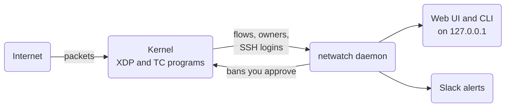

**[Try the live demo](/demo/)**: the same web UI on demo data, in your browser. Nothing to install and no server behind it.

```shell
curl -fsSL https://gotempsh.github.io/netwatch/install.sh | sh
npx skills add gotempsh/netwatch     # the agent skill
```

Or let your coding agent set it up:

<!-- copy-prompt -->

netwatch counts every packet in the kernel with eBPF/XDP and records every connection with the process or container behind it. It flags port scans, brute force, floods and listed attackers, and proposes bans that you approve, or enforces them at XDP speed. It starts in **observe** mode: it watches and proposes, and blocks nothing until you approve.



It runs as root and sees all your traffic, so [Security and privacy](/security) lists what it does with that: every request it makes to the internet, what it stores, and how to verify a release. [Compared to other tools](/comparison) sets it next to fail2ban, CrowdSec, ntopng, Suricata, OpenSnitch and Little Snitch.

## Get started

<!-- cards -->
- [**Installation** Linux release, Docker image, macOS, or from source.](/installation)
- [**Quick start** Open the UI, read the first insights, approve a ban.](/quick-start)
- [**The web UI** A tour of every page, with screenshots.](/web-ui)
- [**Live demo** Click through the web UI on demo data, no install.](/demo/)
- [**CLI reference** Every command and its options.](/cli)
- [**Security and privacy** What runs as root, what leaves the machine, what is stored.](/security)
- [**Compared to other tools** fail2ban, CrowdSec, ntopng, Suricata, OpenSnitch, Little Snitch.](/comparison)

## See it

<!-- steps -->

### Open the overview

Live packets, SYNs and drops, flagged sources, bans, pending proposals and SSH failures, with the insights that need you and the command that acts on each.


### Find who is probing you

Every address that sent traffic, scored 0–100 for what it did: port scans, SSH brute force, exploit requests, threat-feed listings. Open one to see why it scored what it did and every port it touched.


### See what talks to what

Every connection in and out, with the process or container that owns it, the DNS name or TLS SNI of the other side, bytes each way, TCP state and latency.


### Follow the logins

Failed passwords, invalid users and successful logins from sshd and Tailscale SSH, with the addresses that failed most. A login after failures, or from a network not seen in 90 days, is flagged.


### Approve the bans

In observe mode every ban is a proposal with its reason, confidence and the command that applies it. Approve it with `sudo netwatch approve <id>`, or switch to enforce mode once the proposals look right.


<!-- /steps -->

[The web UI](/web-ui) goes through every page, with the command that gives the same view in a terminal.

## What you get

- **Counts traffic in the kernel.** Packets, bytes, SYNs, UDP and ICMP per source, plus every local port each source touches. The XDP program fails open: it only drops sources you banned.
- **Records every connection.** On the host, Tailscale, WireGuard and Docker interfaces: who connected to whom, bytes and rates, TCP state and latency, the owning process with its systemd service or container, TLS SNI, HTTP host, SSH banners and the DNS name the address came from.
- **Detects attacks.** Port scans, probes of services that should never be public, brute force, floods, threat-feed matches and about 60 known exploit requests. Each source gets a 0–100 score.
- **Follows SSH logins.** Password guessing, invalid users, a login after failures and logins from a country or network not seen in 90 days.
- **Proposes or enforces bans.** Observe mode turns every ban into a proposal you approve. Enforce mode bans automatically with escalating TTLs. Infrastructure you depend on (gateway, VPN peers, Cloudflare) is never banned.
- **Explains itself.** Insights turn the data into concrete advice, each with the command that fixes it.
- **Optionally uses a model.** Any OpenAI-compatible endpoint, local or hosted, reviews the sources the rules can't settle and compiles ban policies written in plain English. It is built for cheap models and small token budgets.
- **Works with your coding agent.** `netwatch skill --install` teaches Claude Code, Codex, Cursor and other agents to investigate with netwatch and to ask before banning anything. See [AI agents](/agents).
- **Stays on the host.** The web UI and API are read-only and listen only on `127.0.0.1`; every change goes through `sudo netwatch` and a root-only socket.

## How it fits together


The daemon is one Rust binary with the eBPF programs and the web UI embedded. State lives in a single SQLite file. On macOS the same daemon captures from `/dev/bpf` and bans with pf instead.

## For agents

Every page is also plain Markdown at its address with `.md` in place of the trailing slash (`/installation/` is `/installation.md`; this page's is [`/index.md`](/index.md)), or use **Copy page** at the top. [`/llms.txt`](/llms.txt) lists every page and [`/llms-full.txt`](/llms-full.txt) holds them all in one file.

The [agent skill](/cli#agent-skill) teaches a coding agent which command answers which question, how to read scores, and to ask before banning anything.
