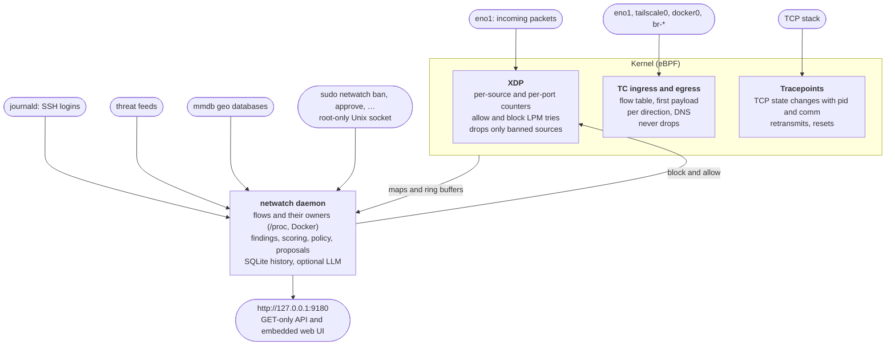

netwatch counts every packet in the kernel with eBPF/XDP and keeps a record of every connection, together with the process or container behind it. It flags port scans, brute force, floods and listed attackers, and proposes bans that you approve, or enforces them at XDP speed. You browse everything in a read-only web UI that listens only on `127.0.0.1`, or from the command line.


```shell
curl -fsSL https://gotempsh.github.io/netwatch/install.sh | sh
```

That installs a systemd service (a launchd daemon on macOS) in **observe** mode: it watches and proposes, and blocks nothing until you approve. [Installation](/installation) covers Docker, macOS and building from source.

It runs as root and sees all your traffic, so [Security and privacy](/security) lists what it does with that: every request it makes to the internet, what it stores, and how to verify a release. [Compared to other tools](/comparison) sets it next to fail2ban, CrowdSec, ntopng, Suricata, OpenSnitch and Little Snitch.

## What it does

- **Counts traffic in the kernel.** Packets, bytes, SYNs, UDP and ICMP per source, plus every local port each source touches. The XDP program fails open: it only drops sources you banned.
- **Records every connection.** On the host, Tailscale, WireGuard and Docker interfaces: who connected to whom, bytes and rates, TCP state and latency, the owning process with its systemd service or container, TLS SNI, HTTP host, SSH banners and the DNS name the address came from.
- **Detects attacks.** Port scans, probes of services that should never be public, brute force, floods, threat-feed matches and about 60 known exploit requests. Each source gets a 0–100 score.
- **Follows SSH logins.** Password guessing, invalid users, a login after failures and logins from a country or network not seen in 90 days.
- **Proposes or enforces bans.** Observe mode turns every ban into a proposal you approve. Enforce mode bans automatically with escalating TTLs. Infrastructure you depend on (gateway, VPN peers, Cloudflare) is never banned.
- **Explains itself.** Insights turn the data into concrete advice, each with the command that fixes it.
- **Optionally uses a model.** Any OpenAI-compatible endpoint, local or hosted, reviews the sources the rules can't settle and compiles ban policies written in plain English. It is built for cheap models and small token budgets.
- **Works with your coding agent.** `netwatch skill --install` teaches Claude Code, Codex, Cursor and other agents to investigate with netwatch and to ask before banning anything. See [AI agents](/agents).

## How it works



The daemon is one Rust binary with the eBPF programs and the web UI embedded. State lives in a single SQLite file. On macOS the same daemon captures from `/dev/bpf` and bans with pf instead.

## Where to next

<!-- cards -->
- [**Installation** Linux release, Docker image, macOS, or from source.](/installation)
- [**Quick start** Open the UI, read the first insights, approve a ban.](/quick-start)
- [**The web UI** A tour of every page, with screenshots.](/web-ui)
- [**CLI reference** Every command and its options.](/cli)
- [**Security and privacy** What runs as root, what leaves the machine, what is stored.](/security)
- [**Compared to other tools** fail2ban, CrowdSec, ntopng, Suricata, OpenSnitch, Little Snitch.](/comparison)
