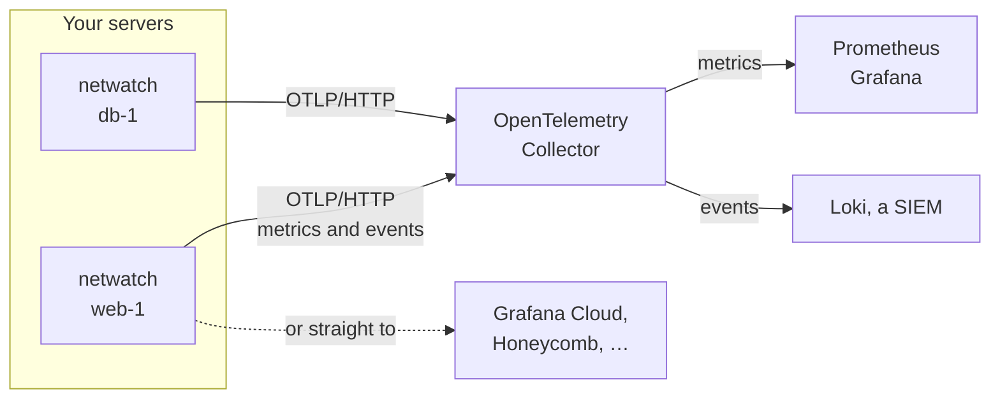

Each netwatch watches one host and keeps its UI on `127.0.0.1`. To see every server in one place, netwatch can push to an OpenTelemetry collector:

- **metrics**: traffic, sources, bans, proposals, flows and throughput, aggregated per host, interface and process;
- **events**: findings, ban proposals, bans, SSH logins and new listeners, as OpenTelemetry log records.

It pushes over OTLP/HTTP with protobuf. Like Slack, it is outbound only: nothing new listens on the host.



## Turn it on

```toml
[otel]
enabled = true
endpoint = "http://127.0.0.1:4318"   # an OTLP/HTTP receiver; /v1/metrics and /v1/logs are appended
interval_secs = 60                   # seconds between metric exports
metrics = true
logs = true                          # events as log records
```

Restart netwatch. Its log then names the endpoint, in a line starting `opentelemetry: sending`.

## Check that it arrives

Before wiring a backend, point netwatch at a collector that prints what it receives:

```yaml
# collector.yaml
receivers:
  otlp:
    protocols:
      http:
        endpoint: 127.0.0.1:4318
exporters:
  debug:
    verbosity: detailed
service:
  pipelines:
    metrics: { receivers: [otlp], exporters: [debug] }
    logs: { receivers: [otlp], exporters: [debug] }
```

```shell
docker run --rm --network host \
  -v $PWD/collector.yaml:/etc/otelcol-contrib/config.yaml:ro \
  otel/opentelemetry-collector-contrib
```

The `netwatch.started` event shows up as soon as netwatch starts, and the metrics after `interval_secs`. A finding looks like this:

```text
SeverityText: WARN
EventName: netwatch.finding
Body: Str(Port scan: 299 local ports in 10 min (298 closed): 1, 2, 3, 4, 5, 6, +293 more)
Attributes:
     -> source.address: Str(203.0.113.9)
     -> netwatch.finding.kind: Str(port_scan)
     -> netwatch.score: Int(90)
     -> netwatch.location: Str(--)
```

Nothing arriving? See [When the collector is down](#when-the-collector-is-down) for what netwatch logs.

Backends that need a token take it as a header. Put the headers in `/etc/netwatch/env` (mode 0600), in the standard `OTEL_EXPORTER_OTLP_HEADERS` format, `key=value` pairs separated by commas, with values percent-encoded:

```shell
OTEL_EXPORTER_OTLP_HEADERS=Authorization=Basic%20dXNlcjp0b2tlbg==
```

`OTEL_EXPORTER_OTLP_LOGS_HEADERS` and `OTEL_EXPORTER_OTLP_METRICS_HEADERS` set different headers for events and metrics; each takes the place of `OTEL_EXPORTER_OTLP_HEADERS` for its signal. An entry that isn't a valid `key=value` header turns export off with an error naming the variable and the entry's position, never its content. Extra resource attributes (`deployment.environment`, a cluster name, …) come from the standard `OTEL_RESOURCE_ATTRIBUTES` variable.

## A collector for Prometheus and Loki

Run the [OpenTelemetry Collector](https://opentelemetry.io/docs/collector/) next to netwatch, or once for many hosts. This configuration serves the metrics to Prometheus and sends the events to Loki:

```yaml
receivers:
  otlp:
    protocols:
      http:
        endpoint: 127.0.0.1:4318

exporters:
  prometheus:
    endpoint: 0.0.0.0:8889          # scrape this from Prometheus
    resource_to_telemetry_conversion:
      enabled: true                 # a host_name label on every series
  otlphttp/loki:
    endpoint: http://loki:3100/otlp

service:
  pipelines:
    metrics:
      receivers: [otlp]
      exporters: [prometheus]
    logs:
      receivers: [otlp]
      exporters: [otlphttp/loki]
```

```shell
docker run -d --name otelcol --network host \
  -v $PWD/collector.yaml:/etc/otelcol-contrib/config.yaml:ro \
  otel/opentelemetry-collector-contrib
```

With one collector for many hosts, have it listen on an address the hosts can reach (`0.0.0.0:4318`, behind your firewall or a private network), and set each netwatch's `endpoint` to it.

## Straight to a hosted backend

Hosted backends accept OTLP/HTTP directly: set `endpoint` to their OTLP URL and the token in `/etc/netwatch/env`. Each backend's documentation has the URL for your region.

**Grafana Cloud** (metrics to Mimir, events to Loki). The stack's OpenTelemetry page shows the endpoint, the instance ID and a token; the header is `Basic` with base64 of `instance-id:token`:

```toml
[otel]
enabled = true
endpoint = "https://otlp-gateway-prod-eu-west-2.grafana.net/otlp"
```

```shell
# /etc/netwatch/env
OTEL_EXPORTER_OTLP_HEADERS=Authorization=Basic%20MTIzNDU2OmdsY19leGFtcGxl
```

**Honeycomb**. Metrics need a dataset name; events go to the `netwatch` dataset on their own, from `service.name`:

```toml
[otel]
enabled = true
endpoint = "https://api.honeycomb.io"
```

```shell
# /etc/netwatch/env
OTEL_EXPORTER_OTLP_HEADERS=x-honeycomb-team=YOUR_API_KEY
OTEL_EXPORTER_OTLP_METRICS_HEADERS=x-honeycomb-team=YOUR_API_KEY,x-honeycomb-dataset=netwatch-metrics
```

Datadog, New Relic and others work the same way where they take OTLP/HTTP; otherwise send to a collector and use its exporter for them.

## In Docker

Add `[otel]` to the mounted `netwatch.toml` and pass the header variables with `-e`, as for Slack (see [Docker](/docker#configuration)):

```shell
docker run -d --name netwatch --restart unless-stopped --stop-timeout 30 \
  --network host --pid host --privileged \
  -v netwatch-data:/var/lib/netwatch -v /run/netwatch:/run/netwatch \
  -v /etc/netwatch/netwatch.toml:/etc/netwatch/netwatch.toml:ro \
  -e OTEL_EXPORTER_OTLP_HEADERS -e OTEL_RESOURCE_ATTRIBUTES \
  ghcr.io/gotempsh/netwatch:latest
```

With `--network host`, `http://127.0.0.1:4318` reaches a collector on the same host.

## Metrics

Every series carries the resource attributes `service.name` (`netwatch`), `service.version`, `host.name` and `os.type`.

| Metric | Type | Unit | Attributes |
|---|---|---|---|
| `netwatch.packets` | counter | `{packet}` | |
| `netwatch.bytes` | counter | `By` | |
| `netwatch.packets.inbound` | counter | `{packet}` | |
| `netwatch.packets.syn` | counter | `{packet}` | |
| `netwatch.packets.banned` | counter | `{packet}` | |
| `netwatch.packets.dropped` | counter | `{packet}` | |
| `netwatch.events.lost` | counter | `{event}` | |
| `netwatch.connects.failed` | counter | `{connection}` | `network.transport` |
| `netwatch.sources.tracked` | gauge | `{source}` | |
| `netwatch.sources.active` | gauge | `{source}` | |
| `netwatch.sources.flagged` | gauge | `{source}` | |
| `netwatch.bans.active` | gauge | `{ban}` | |
| `netwatch.proposals.pending` | gauge | `{proposal}` | |
| `netwatch.ssh.failures` | gauge | `{attempt}` | |
| `netwatch.listeners.exposed` | gauge | `{socket}` | |
| `netwatch.flows.active` | gauge | `{flow}` | `network.transport`, `netwatch.direction` |
| `netwatch.interface.throughput` | gauge | `bit/s` | `network.interface.name`, `network.io.direction` |
| `netwatch.process.flows` | gauge | `{flow}` | `process.executable.name`, `container.name`, `netwatch.unit` |
| `netwatch.process.throughput` | gauge | `bit/s` | `process.executable.name`, `container.name`, `netwatch.unit`, `network.io.direction` |

The packet counters cover the primary interface since netwatch started. `netwatch.sources.active` counts sources seen in the last 10 minutes, `netwatch.sources.flagged` those at or above `ban.review_score`, `netwatch.ssh.failures` failed logins in the last hour (wrong passwords and nonexistent users), and `netwatch.listeners.exposed` services bound to anything but loopback (LAN and wildcard addresses included, as in the UI). `netwatch.direction` is `in` (they connected to us), `out` or `unknown`.

Through the collector's Prometheus exporter the names become `netwatch_packets_total`, `netwatch_flows_active`, `netwatch_interface_throughput_bit_per_second` and so on.

There are no per-address series: thousands of source addresses would overwhelm a metrics backend. Per-address detail is in the events. The per-process metrics name the 20 busiest processes (by name, container and service, never by pid) and add the rest up as `other`.

## Queries and alerts

With the collector configuration above, in Prometheus:

```text
# Packets dropped from banned sources, per host
sum by (host_name) (rate(netwatch_packets_banned_total[5m]))

# Ban proposals waiting for a person (alert when > 0 for 15m)
max by (host_name) (netwatch_proposals_pending) > 0

# A service started listening on a non-loopback address
delta(netwatch_listeners_exposed[10m]) > 0

# Received throughput per interface
netwatch_interface_throughput_bit_per_second{network_io_direction="receive"}
```

Events land in Loki with their attributes as fields, dots turned into underscores:

```text
# Every finding about one address
{service_name="netwatch"} | source_address="203.0.113.9"

# Port scans per source in the last hour
sum by (source_address) (count_over_time({service_name="netwatch"} | netwatch_finding_kind="port_scan" [1h]))

# Failed SSH logins on one host
{service_name="netwatch"} | host_name="web-1" | netwatch_ssh_event="failed"
```

## Events

Each event is a log record with an event name, a severity, a readable body and attributes:

| Event | When | Severity | Attributes |
|---|---|---|---|
| `netwatch.started` | the daemon starts | INFO | `netwatch.mode`, `network.interface.name` |
| `netwatch.finding` | a finding is new or worse, and every 5 minutes while it lasts | WARN at or above `ban.recommend_ban_score`, else INFO; ERROR for the CVE-2026-98432 trigger | `source.address`, `netwatch.finding.kind`, `netwatch.score`, `netwatch.location` |
| `netwatch.proposal` | a ban or review is proposed | WARN for bans, INFO for reviews | `netwatch.proposal.id`, `netwatch.action`, `netwatch.target`, `netwatch.proposed_by`, `netwatch.confidence`, `netwatch.ttl` |
| `netwatch.ban` | a ban is applied: approved, manual, by policy in enforce mode or by the model | WARN | `netwatch.target`, `netwatch.banned_by`, `netwatch.ttl` |
| `netwatch.unban` | a ban expires or is lifted | INFO | `netwatch.target`, `netwatch.reason` |
| `netwatch.ssh` | an SSH or Tailscale SSH login, failure or invalid user | INFO | `netwatch.ssh.event`, `user.name`, `source.address`, `netwatch.ssh.method`, `netwatch.location` |
| `netwatch.listener` | a service starts or stops listening | WARN when it starts on a public or wildcard address (as the Slack alert), else INFO; `netwatch.exposed` is true for any address but loopback, as `netwatch.listeners.exposed` counts | `netwatch.listener.event`, `network.transport`, `server.address`, `server.port`, `netwatch.exposed`, `process.executable.name`, `process.pid`, `container.name`, `netwatch.unit` |

`netwatch.finding.kind` is one of the [finding kinds](/bans-and-policy#rules-as-json), and `netwatch.ttl` is in seconds. `netwatch.ssh.event` is `accepted`, `failed` or `invalid_user`, and `netwatch.listener.event` is `listen` or `unlisten`. Unlike Slack, every event is sent: filter in the collector or the backend.

## When the collector is down

Exports run on their own threads and never block detection or bans. Events wait in a queue of 2048; while it is full, new events are dropped, and the log says so once (with the total when netwatch stops). Each failed export is logged:

```text
WARN  opentelemetry-otlp] name="Export.Failed.Exhausted" operation="HttpLogsClient.Export" retries=3 …
ERROR opentelemetry_sdk] name="BatchLogProcessor.ExportError" error="Operation failed: HTTP export failed: network error"
```

On shutdown netwatch sends what is still queued, waiting 5 seconds at most.
